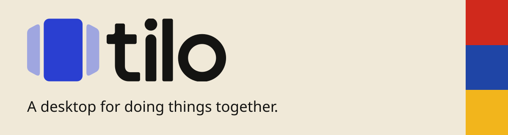

<picture>

  <source media="(prefers-color-scheme: dark)" srcset="docs/brand/banner-dark.svg">
  
</picture>

[Website](https://tilo.so) · [Contribute](CONTRIBUTING.md) ·
[Build an app](docs/app-development.md) ·
[Source & issues](https://code.tilo.so/tilo/tilo)

Tilo is a Linux desktop built around collaboration and around working across
your own devices. You share a _workspace_ with someone and work together in
every Tilo app, with full history, undo, search and sync between devices and
people. You can add AI agents too, with their own permissions and history.

We build the desktop, the apps and the system underneath them together. Tilo
is **early alpha**: expect things to break, and don't trust it with your only
copy of important data.

## How it works

- **Workspaces are the unit of collaboration.** Each has its own members,
  roles, apps, layout and data, and is on every device of every member.
- **A workspace has one set of resources.** Files, mail, calendar, vault,
  models and agents belong to the workspace, shared under the permissions its
  owners set.
- **One identity, and it controls your devices.** A member is an identity; each
  of their devices has its own key, certified by that identity, and gets their
  workspaces. Devices sync directly over iroh, end to end encrypted with MLS.
- **Decentralized first.** A server is just a device that stores more; Tilo
  needs none. [tilo.sh](https://tilo.sh) is our cloud offering.
- **All shared state is CRDT.** Edits from several people and devices merge.
- **Apps are resources, actions and views.** An app declares its typed state
  and the actions that change it; collaboration, history and undo,
  permissions, sync and search come from that. Scripts, assistive technology,
  automations and agents use the same actions as the buttons, and when an agent
  acts, every view of that resource shows it.
- **Views compose.** Any resource can be shown again in another view, and a
  new view can be written quickly in tilolang, also by an agent in a chat.
- **The shell is a view.** Launcher, top bar and settings are built on the same
  toolkit and model as every other app, and you can customize it deeply. Windows sit in horizontally
  scrolling strips; tabs can group different apps.

The [architecture overview](docs/architecture/README.md) explains the model
and where it lives in the code; [`workspace.md`](docs/architecture/workspace.md)
is the full specification. The [apps directory](apps/README.md) lists the apps.

## Try it

There is no public release download yet. [Getting started](docs/getting-started.md)
covers virtual machines, adding the desktop to an existing Linux system and
installing the OS. From a checkout, one command runs it:

```sh
cargo desktop     # the desktop in a window on your desktop
cargo headless    # the session with no window, for agents and tests
cargo web         # the web desktop on the local hosting stack
```

[CONTRIBUTING.md](CONTRIBUTING.md#run-it) says what each needs and does.

## Help build it

You don't need to understand the whole system to help, or even to program: bug
reports, small fixes, accessibility testing, translations, documentation and
design feedback all count. [CONTRIBUTING.md](CONTRIBUTING.md) takes you from a
checkout to a pull request; [Build an app](docs/app-development.md) covers the
app SDK.

Our home is [code.tilo.so/tilo/tilo](https://code.tilo.so/tilo/tilo).
[GitHub](https://github.com/tilo-os/tilo) is a mirror; please send issues and
pull requests to Forgejo. People and coding agents are both welcome; if you
use an agent, understand the change you submit and say what you tested.
[AGENTS.md](AGENTS.md) is for the agent.

## License and security

Tilo is open source: everything you need to publish an app is MIT, the rest is
AGPL 3.0. See [LICENSING.md](LICENSING.md).

Please report vulnerabilities privately as described in
[SECURITY.md](SECURITY.md), not in a public issue.
