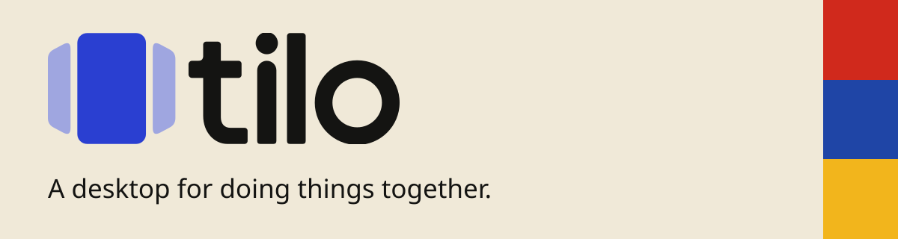

<picture>

  <source media="(prefers-color-scheme: dark)" srcset="docs/brand/banner-dark.svg">
  
</picture>

[Website](https://tilo.so) · [Contribute](CONTRIBUTING.md) ·
[Build an app](docs/developers/getting-started.md) ·
[Source & issues](https://code.tilo.so/tilo/tilo)

Tilo is a Linux desktop built around collaboration, excellent integration
between devices and user experience/freedom. You can share a _workspace_ with
someone and work together in all Tilo apps. Tilo gives you full history, search
and sync between devices and people, for all resources. You can also add AI
agents, with their own permissions and history.

We're building the desktop, the apps, and the system underneath them together.
It's a lot of work, and it's still **early alpha**. Expect things to break.
Please don't trust Tilo with your only copy of any important data at the moment.

## What

- **Workspaces you can share:** Each has its own collaborators, permissions,
  hosts, apps and data. Your computer draws Tilo apps locally, even if you are
  not hosting the workspace.
- **Scrolling window manager:** Apps sit in horizontally scrolling strips. Tabs
  can group different apps, not just documents in one app.
- **Collaboration across apps:** Files, notes, terminals and the other apps use
  the same underlying system for shared state, history and undo.
- **One way to do things:** The controls you use, assistive technology, scripts
  and agents reach the same resources and actions.
- **Strong defaults:** Apps use shared controls, theming, search and storage
  rather than rebuilding them independently.

Take a look at our [architecture guide](docs/architecture/README.md) if you want
to know more theoretical stuff. The [apps directory](apps/README.md) has a full
app list with per-app status and screenshots.

## Can I try it

Start with [Getting Tilo onto a computer](docs/getting-started.md). It covers
virtual machines, adding the desktop to an existing Linux system, and installing
the complete OS.

We're not offering a public release download yet. If you'd like to work on Tilo,
the [development guide](DEVELOPMENT.md) has the dev VM and local build paths. A
VM is the better place to experiment than your everyday desktop.

## Want to help

Thanks! You don't need to understand the whole system to make a useful
contribution, you don't even need to know programming. Bug reports, small fixes,
accessibility testing, translations, documentation and design feedback all help.
If you do want to contribute code and use AI agents, please ensure you
understand what you are doing.

Start with [CONTRIBUTING.md](CONTRIBUTING.md). It explains where to ask, how to
find the relevant code and how to submit a change.

Our home is [code.tilo.so/tilo/tilo](https://code.tilo.so/tilo/tilo).
[GitHub](https://github.com/tilo-os/tilo) is a mirror; please send issues and
pull requests to Forgejo.

People and coding agents are both welcome. If you're using an agent, please
understand the change you're submitting and tell us what you tested.
[AGENTS.md](AGENTS.md) is for the agent; you don't need to follow its operating
routine yourself.

## Working on the code

Tilo is one Rust workspace. Rustup selects the toolchain pinned in
`rust-toolchain.toml`. Native dependencies and platform-specific setup are in
[DEVELOPMENT.md](DEVELOPMENT.md).

You can build individual pieces rather than the whole OS:

```sh
cargo build --locked -p shell        # desktop compositor and control tools
cargo build --locked -p tilo-ui      # UI toolkit
cargo build --locked -p tilo-fs      # collaborative filesystem
cargo build --locked -p file-explorer
```

For a focused shell test on Linux:

```sh
cargo test --locked -p shell --test it interaction_test::
```

Use [t](docs/t.md) for broader checks and remote builds.
[Headless testing](docs/headless-testing.md) covers driving apps and rendering
screenshots without touching your desktop.

A few useful places:

| You're interested in…            | Start here                                                |
| -------------------------------- | --------------------------------------------------------- |
| A particular feature or library  | [Code map](docs/codemap.md)                               |
| Writing your own app             | [App developer guide](docs/developers/getting-started.md) |
| The UI toolkit and app framework | `crates/sdk/`                                             |
| The compositor and desktop       | `crates/session/shell/`                                   |
| Files and storage                | `crates/system/fs/`                                       |
| The OS image                     | `os/`                                                     |

## License and security

Tilo is fully open source, see [LICENSE.md][LICENSE.md] for licensing details
(short story: everything you need to publish an app is MIT, all other code is
AGPL 3.0)

Please report vulnerabilities privately using [SECURITY.md](SECURITY.md), not a
public issue.
