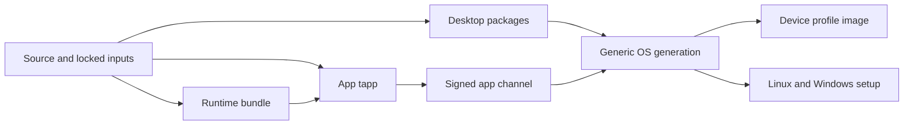

# CI and packaging roadmap

This roadmap keeps routine development fast while Tilo grows into a release
system for apps, Linux desktop packages, installers and complete OS images. It
describes the desired system and names the evidence already present in this
repository. A workflow definition is not proof that its runner, signing
identity or public endpoint is ready.

## Platform decision

Keep Forgejo Actions as the PR surface and job executor. It already provides
the checks, native runner labels, protected tags and OIDC entry points used by
the repository. Replacing it would move jobs without solving the main problem:
deciding which product nodes are stale and reusing the rest.

Move that decision into a small build coordinator. It computes a content-bound
graph, reads immutable receipts and dispatches narrow Actions workflows. YAML
remains responsible for isolated execution and credential boundaries, not for
remembering the whole product graph. Reconsider the executor only if measured
limits in Actions prevent native-host admission, durable DAG state or timely
feedback after the coordinator is in service.

## Product matrix

| Product | Present evidence | Next production step |
| --- | --- | --- |
| Tilo/Linux apps | [`release-apps.yml`](../.forgejo/workflows/release-apps.yml) plans every PR and packages affected apps on relevant `main` pushes. It compiles selected app binaries with full-collection dependency features and publishes immutable tapps and collections to Forgejo, reusing unchanged members. Explicit and tagged runs retain x86-64 and ARM64. | Populate the signed development catalogue at `apps.tilo.so`, then make ARM64 continuous after its native lane meets the same reliability target. A toolkit change rebuilds only its transitive app closure. |
| Windows apps | The toolkit and local installer exist; [`ci-product-matrix.md`](ci-product-matrix.md) records the missing release qualification. | Keep this optional. Qualify a small x86-64 set on a disposable native host before choosing archive or MSIX, signing, update and rollback contracts. Add ARM64 only after x86-64 is useful. |
| macOS apps | No standalone release path is qualified. | Deferred. Do not allocate runners or publish packages. |
| Linux desktop | [`release-desktop.yml`](../.forgejo/workflows/release-desktop.yml) defines Debian 13, Ubuntu 24.04, Fedora 44, Arch and Nix packages. PRs run preflight; scheduled, manual and tagged runs perform native builds. | Install-test each emitted repository package, retain a last-known-good set per distribution and architecture, then promote one signed desktop release manifest. |
| Linux setup program | [`release-imager.yml`](../.forgejo/workflows/release-imager.yml) builds installer media, AppImage, tar and Flatpak outputs on native x86-64 and ARM64 lanes. | Record clean-machine install, update and rollback receipts against the exact published OS digest. |
| Windows setup program | The same workflow retains native x86-64 and ARM64 build, signing and WinGet publication jobs. | Prove runner availability and clean-VM install/uninstall on both architectures before calling a tag releasable. |
| macOS setup program | Native Intel and Apple-silicon jobs build, sign, notarize, staple, mount, and launch the Imager; publication requires both DMGs/app zips and both Homebrew cask installs. | Supply ephemeral native runners and the protected macOS/Homebrew brokers before a release tag; absent infrastructure fails closed. |
| Generic OS | [`build-image.yml`](../.forgejo/workflows/build-image.yml) releases nightly, from a version tag or from a `release` dispatch of `main` (dev images come from `os-dev.yml`), and retains x86-64/ARM64 signing, SBOM, provenance, reproducibility and VM gates. | Keep OS publication manual. Shorten release lead time by consuming already qualified app, desktop, kernel, RPM and WPE digests rather than rebuilding them. |
| Device OS | [`os/hardware/README.md`](../os/hardware/README.md) separates architecture from hardware profile; Lenovo 83ED has a profile and a manual development path. | Treat each device profile as a signed overlay on a qualified generic generation. Require physical boot, input, display, network, suspend, update and rollback evidence; a generic VM result cannot replace it. |

## Build graph

Every reusable node gets an input fingerprint containing:

- content hashes of the transitive source dependency closure;
- locked Rust, system-package and external-asset inputs;
- builder image, compiler, linker, target triple and native SDK identity;
- architecture, minimum ISA, runtime ABI and hardware profile where applicable;
- build recipe and the policy version that accepts the output.

Record the source revision in provenance separately; an unrelated commit must
not invalidate reusable build inputs.

The output receipt binds that fingerprint to immutable artifact digests, logs,
test results, SBOM and provenance. A cache hit may accelerate a build, but only
an accepted receipt permits skipping the build.

The coordinator walks reverse dependencies from changed inputs. It builds the
smallest stale closure, then assembles collections and release manifests from
new and previously accepted nodes. A shared toolkit or runtime change can
legitimately select the full app fleet. A documentation-only change selects no
native build. Unknown inputs fail toward a broader build until mapped.

Each product and target has a last-known-good receipt. Failed work leaves that
receipt and every public channel unchanged. A new build can reuse it only when
the complete input fingerprint and acceptance policy still match. Baseline
creation is explicit, and periodic full builds check that selective reuse has
not hidden dependency drift.

## Storage and cache tiers

| Tier | Purpose | Rule |
| --- | --- | --- |
| Worker-local | Preloaded runner images, OCI layers, Cargo downloads and the current job's target tree | Prefer local reuse and measure misses. Never share a writable Cargo target directory between worktrees. |
| Compiler | S3-backed sccache, separated by compiler, target and trust domain | Aim for unchanged dependency hits. Release verification that needs stronger producer trust uses a restricted namespace or rebuilds cold. |
| Regional OCI/ECR | CI images, builder images, frozen inputs and BuildKit caches close to runners | Replicate by digest before rollout. Runner startup must not depend on repeatedly pulling large images through the Forgejo control-plane node. |
| Shared Actions cache | Workflow caches restored across disposable runners | Save/restore is qualified by the small cross-runner smoke below; measure real dependency archives separately. This is distinct from sccache and immutable release artifacts. |
| Forgejo packages | Immutable tapps, collections, desktop packages, receipts and workflow-local handoffs | Use immutable versions and digests. Mutable names only point to accepted artifacts. |
| Tilo registry | Signed app store metadata, channel metadata and public app downloads | Public HTTPS at `apps.tilo.so` is deployed through Argo. Every app tapp published by `release-apps.yml` is also submitted as a signed add/update request; the registry's isolated collector and publisher jobs verify and promote accepted first-party entries. Both x86-64 and ARM64 entry metadata are supported. |

Eviction starts with reconstructible local data. Accepted artifacts, receipts,
signatures and the inputs required for cross-time reproduction follow a defined
retention policy and are backed up. Cache availability must never decide what
is released.

## Gates and promotion

| Boundary | Required work |
| --- | --- |
| Pull request | Cheap applicability plan, lint and affected checks for the exact head. Do not build the whole OS. Show the selected products and expected expensive work before merge. A PR merges once the required checks pass for its current head and the branch is up to date with `main`; review state is informational and never blocks integration. See [delivery workflow](../DEVELOPMENT.md#routine-delivery-workflow). |
| `main` | Preserve check/lint for every commit. Package the affected Tilo/Linux apps and update immutable collection inputs. Advance a public development channel only after registry publication is enabled. Coalesce superseded expensive work without discarding fast results. |
| Scheduled integration | Rebuild full app baselines, Linux desktop packages and a generic x86-64 OS candidate. Rotate ARM64 and other costly coverage according to measured drift and capacity. |
| App/desktop release | Reuse accepted build nodes, install-test the release set, sign artifacts and provenance, then atomically move a channel manifest. |
| OS release | Manual tag or explicit publish dispatch only. Require native x86-64 and ARM64 outputs, independent reproducibility, installed-VM boot/update/rollback, signatures, SBOM and provenance before promotion. |
| Device release | Start from an accepted generic OS generation. Add model-specific firmware/profile inputs and require physical-device acceptance for that exact digest. |

Promotion is `candidate -> development -> stable`; products may stop at any
stage. Promotion changes a small signed manifest, never artifact bytes. Rollback
moves that manifest to the previous accepted digest. App channels may advance
continuously after stabilization. OS stable channels always require an explicit
release action.

## Service levels and developer evidence

The retained baseline is mixed. A warm main lint task reached container creation
in 344 ms and completed in 127.9 s, while a generic full-builder cold pull took
236.9 s. The exact runs and limits are recorded in
[`ci-emergency-relief.md`](ci-emergency-relief.md). Separately, the measured
nightly workspace run fell from 573.0 s at a 20.61% sccache hit rate to 436.71 s
at 93.35%; [`ci-performance.md`](ci-performance.md) records the counters and CPU
cost. These are comparison points, not current guarantees.

On 2026-09-20, [agent-platform smoke 834](https://code.tilo.so/tilo/agent-platform/actions/runs/834)
passed all four jobs after the shared Actions cache route was deployed. One runner
saved a 274-byte cache at 12:41:45.755 UTC; another restored it at 12:41:52.949 UTC.
The same smoke recorded a Rust sccache hit. This proves cross-runner connectivity
and reuse, not large-cache throughput, sustained hit rates or the image-pull SLO.

The registry's internal acceptance at 12:43 UTC on 2026-09-20 used GitOps revision
`85c68534d7a98a0e4c92063256aa77bb1fff6c7c`: registry and monitoring were Synced/Healthy,
protocol 3 served signed sequence 2 with **zero entries**, and all three internal
probes passed. The artifact proxy returned the expected 894,976-byte package with
matching SHA-256; invalid paths and methods returned 404. The CSI snapshot was
ready, but the qualification backup failed because the Backblaze storage cap was
exceeded. Offsite upload and restore remain unverified. The later public rollout
verified HTTPS, the trusted registry root and the same 894,976-byte calculator
artifact. The signed catalogue is still empty: public
read access does not establish CI catalogue publication or disaster recovery.

The targets below are operating goals. Report p50 and p95 over seven and 30
days, split by workflow and architecture; do not declare them met from one run.

| Signal | Initial target |
| --- | ---: |
| Push to PR eligibility result | p50 under 5 min; p95 under 10 min |
| Normal job queue time | p95 under 2 min |
| Cached runner image acquisition and container creation | p95 under 30 s |
| No-op app packaging decision | p95 under 2 min, with no native runner |
| One-app change to development channel | p50 under 15 min; p95 under 30 min |
| Unchanged app artifacts rebuilt | 0 |
| Warm compiler-cache hit rate for unchanged dependencies | at least 90% |
| CI infrastructure failures | under 1% of jobs; automatic retry at most once |
| Orphaned or duplicate expensive jobs | under 0.1% |

Record queue, runner startup, image pull, checkout, compile/test, packaging and
publication separately. Also record selected app count, reused artifact count,
bytes transferred, cache hit rate, rerun reason, time to green and release lead
time. [`tools/ci/timing_report.py`](../tools/ci/timing_report.py) already
separates queue, runner receipt, pull and execution timing; surface those values
in run summaries and a weekly trend. Compare developer experience by median
push-to-green time and manual interventions per merged PR before and after each
rollout.

## Delivery phases

1. **Make continuous apps boring.** Recover the failed offsite backup and verify
   restore, qualify and enable CI submission to the public registry,
   publish the verified x86-64 tapps already produced from `main` into its signed
   development catalogue, retain the last-known-good channel on failure, and show
   timing and selection in every run. Exit when 30 consecutive relevant changes
   need no manual recovery and meet the app SLO.
2. **Scale without multiplying work.** Put the coordinator and receipt store in
   charge of dependency selection, move heavy OCI traffic to regional ECR,
   qualify continuous ARM64 apps, and install-test the Linux desktop matrix.
   Exit when full-baseline runs reproduce selective assemblies and both native
   app lanes meet the reliability target.
3. **Make releases routine.** Promote accepted nodes into Linux/Windows setup
   releases and manual multi-architecture OS releases. Add one-command release
   intent, dry-run output, atomic promotion and rollback. Exit after three
   complete release rehearsals from clean hosts with no artifact rebuild caused
   only by handoff between workflows.
4. **Harden for production.** Add device-farm receipts, disaster recovery for
   registries and receipt state, restricted release-cache writers, transparency
   enforcement and an independent witness. Qualify Windows apps only if their
   product value justifies the matrix. Enable macOS packaging only through a
   separate decision and qualification plan.
