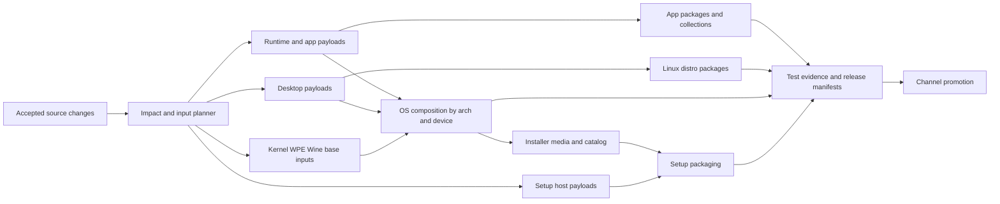

# Continuous builds and the path to production

Priority update from the ARM64 development transcript:
[make one change cheap to test](development-feedback-loop.md). Retaining a usable
baseline, reducing assembly/test setup and consolidating existing helpers are the
first developer-experience slice. Compiler-cache experiments alone do not establish
the dominant end-to-end bottleneck.

Follow-up evidence: [isolated build-graph experiments](ci-build-graph-experiments.md).
The small Linux probe informs cache design; full target/platform qualification
and production workflow activation remain separate steps below.

Status: implementation roadmap with [emergency relief already deployed](ci-delivery-status.md).
Updated: 2026-09-19. Original repository inspection: qos/qos at 032ea136f.
The [main emergency runbook](../ci-emergency-relief.md) records deployed behavior;
the remaining build-graph, retention and promotion contracts below are proposals,
not claims about live configuration.
Companion: [alpha integration plan](alpha-ci-integration.md).

Platform decision prerequisite: [CI execution and build-graph qualifications](ci-platform-decision.md). Keep Actions provisionally, but decide dependency-graph ownership and qualify scheduling before broad workflow refactoring. Compare current Cargo/component reuse with a representative Bazel/rules_rust slice and appropriate Nix component boundaries; do not implement a custom scheduling/build engine merely to preserve Actions.

## Scope and priorities

Build a continuously usable artifact pipeline for a large product family, while retaining fast PR feedback. Alpha optimizes the team's development experience; later production readiness strengthens promotion and acceptance without replacing the build architecture.

User decisions:

- Routine PRs can merge automatically after CI and independent agent review.
- Ordinary branches must not routinely build the entire OS.
- Continuous builds and quick releases are a core requirement now, not a later optional optimization.
- Apps are continuously packaged, including during toolkit stabilization with coalesced fleet rebuilds. OS versions are released only by an explicit human release decision. OS candidate builds remain scheduled or on demand; app publication must not automatically publish an OS release.
- Cover the full non-macOS product matrix, with one explicit staging exception: packaging every individual app for Windows is considered but need not be enabled immediately. Windows setup packages remain required. All macOS compilation, packaging and qualification builds are disabled for push, PR, tag, schedule and manual/full-native requests, including cross-compiled macOS targets. Retain inert definitions and a future explicit activation path.
- Windows toolkit support is expected to merge shortly (user estimate: about one hour). Treat its actual merged revision as the qualification prerequisite; do not diagnose its current absence as a CI defect. The estimated time does not establish completion.

“Continuous” means every accepted change is evaluated, affected product targets converge to a recent tested build, and an exact revision can be requested at any time. It does not mean completing every superseded intermediate commit on every device. Explicit release requests are pinned and must never be silently coalesced away.

For OS/device targets, evaluation records the desired input set continuously, while expensive candidate assembly normally happens on schedule or explicit request. Urgent boot/composition changes can request pre-merge candidates. Continuous app packaging does not imply an OS build or OS channel advancement after every app update.

The principal reuse unit is an immutable, verified component artifact. Compiler and container caches accelerate producing it; the same tested payload should then feed multiple compatible packages and assemblies. This plan does not claim one binary can run on incompatible platforms.

## Verified starting point and gaps

The repository already has Cargo impact selection, remote sccache, registry image caches, independent component workflows, qpkg collections, immutable desktop payloads, native setup packaging, signed catalogs, VM gates and hardware profiles. Extend these rather than replacing everything with a new build system.

Inspection found important differences between intent and implementation:

| Area | Current evidence | Planning consequence |
| --- | --- | --- |
| App release selection | `release-apps.yml` selects the entire default collection on relevant main pushes | Do not describe current main publication as changed-app-only |
| Thin app build | `package-apps.sh` builds the complete default app/runtime graph even for a selected subset | Partial packaging is not yet partial compilation; optimize within the exact runtime boundary |
| App artifact handoff | Packager emits root `tilo-runtime/`; workflow uploads `runtime/**`; assembler expects `runtime/tilo-runtime` | Apparent layout mismatch must be reproduced and repaired before depending on cross-run reuse |
| Builder identity | App workflow uses mutable `qos-builder:latest` | Resolve once to immutable digest and record it in build identity |
| Desktop packaging | Target userspaces invoke compilation; Fedora emits reusable OS payload | Extract build/packaging boundary, preserving ABI-specific builds where necessary |
| Setup program | `release-imager.yml` depends on media, then catalog, then host packages; `release.rs` uses `include_str!` for its catalog | Reuse existing tested media first; catalog changes currently require recompiling/relinking the setup binary |
| Platforms | Setup defines Linux/Windows/macOS x86-64 and ARM64; generic OS has two architectures; `lenovo-83ed` is an ARM64 device profile | A matrix entry or profile is not proof of a working runner, native package, or physical-device qualification |
| Cache behavior | Development assembly docs only establish same-source retries/common prefixes, while WPE has a separate artifact/cache path | Prove cross-revision cache reuse; do not infer it from cache flags |
| Build profiles | Default release is fat LTO; thin-app has different panic/link settings; app workflow overrides some release flags | Profile/feature drift and linking require separate measurement and explicit identities |

Sources: `docs/release-pipeline.md`, `docs/ci-performance.md`, `docs/imager-release-operations.md`, relevant `.forgejo/workflows/`, `dist/apps/package-apps.sh`, `tools/assemble_app_collection.py`, `apps/imager/src/release.rs`, `os/dev/assembly-registry-cache.md`, `os/docs/wpe-stage-cache.md`. These are source inspections, not proof of current successful builds or runner capacity.

## Product and target catalog

### Read-only packaging planner experiment (2026-09-19)

`tools/app_packaging_report.py` now reports affected qpkg apps from Cargo metadata
and candidate artifact identities from committed package/dependency inputs. Run
from a clean checkout (including untracked files), using actual immutable builder
and runtime digests, for example:

```sh
python3 tools/app_packaging_report.py --base HEAD^ \
  --target x86_64-unknown-linux-gnu \
  --builder "$BUILDER_DIGEST" --runtime "$RUNTIME_DIGEST"
```

The repository graph selected one app for a calculator source edit, 53 for a UI
edit, and zero for a documentation edit. Six tests exercise real Cargo metadata
and Git inputs, including deleted manifests, unknown native inputs, dirty and
untracked files, architecture separation and runtime/builder identity changes.
This is report-only: ignored/generated inputs and ambient build environment are
not fully modeled, and no key authorizes artifact reuse or publication.

`experiments/ci-build-graph/selective_compile_probe.py` compiles only a tiny offline
fixture using the repository's pinned toolchain. Selecting one app while retaining
another app's `--features other/feature` fails with Cargo exit 101; explicitly
enabling the shared dependency's feature preserves that feature in the selected
build. Consequently, removing `-p` roots from the current thin-app builder is not
a safe standalone optimization. A next experiment must derive the exact shared
feature union, then verify runtime crate hashes and loader compatibility before
reusing binaries. Keep Forgejo for events and runners, Cargo for compilation
dependencies, and artifact manifests for cross-run reuse; do not reproduce
transitive package dependencies in workflow YAML. No workflow is enabled by this
planner, and OS publication remains a separate manual decision.

Create one versioned product/target catalog, provisionally `release/targets.toml`, consumed by planning, workflow dispatch, package verification and download manifests. Extend app collections and the installation contract; do not maintain another conflicting list by hand. Use explicit valid combinations rather than a Cartesian product of every app, OS, architecture, distro and device.

| Product | Required non-macOS coverage | Reusable boundary and qualification |
| --- | --- | --- |
| Individual apps optimized for qOS | Entire declared app fleet on x86-64 and ARM64, with explicit platform-specific exceptions | Thin qpkg plus exact shared runtime; launch/resource/action tests in matching runtime |
| Standalone Linux apps | All intended host-capable apps, both architectures, explicit minimum ABI/runtime | Per-target host payload to compatible portable/Flatpak/AppImage or native formats; runtime, portal and launch tests |
| Standalone Windows apps | Staged pilot after toolkit merge; retain catalog entries for the intended fleet and both architectures, with continuous fleet packaging deferred pending cost/value review | Native target payload, packaged runtime/resources, setup/portable forms; native launch and integration tests. Pilot results determine activation |
| Whole desktop | Linux x86-64/ARM64 desktop payload, services and app collection | Core desktop/session artifact plus explicitly compatible dependencies; VM/session/collaboration tests |
| Desktop distribution packages | Ubuntu 24.04, Debian 13, Fedora 44, Arch and NixOS/flake, both architectures as the delivery goal | ABI-appropriate payloads, then distro-specific packages; each userspace gets install/upgrade/session tests |
| Setup program | Linux and Windows x86-64/ARM64; current Linux Flatpak/AppImage/tar and Windows setup/standalone/zip forms | Host executable and resources plus pinned catalog; native installation, elevation and safe-write tests |
| OS and installation media | Generic x86-64/ARM64 and each declared device profile, starting with `lenovo-83ed` | Shared rootfs/components plus kernel/firmware/profile overlays, sealed image and medium; per-arch VM and per-device qualification |
| macOS products | Disabled now, preserved as a future target family | No scheduled builds or macOS-required publication barrier until explicitly re-enabled |
| Heavy dependencies | WPE/browser, kernel, Wine/DXVK, runtime, base/RPM/buildroot snapshots, relevant model assets | Independent input-addressed artifacts; fan out only to actual consumers |

The Linux compositor/session is not automatically a native Windows desktop. Windows app packaging is a staged option and Windows setup is required; a native Windows desktop product, if intended, needs its own declared capability contract rather than pretending Linux session packaging covers it. The app called `windows` and Wine/VM integration are not evidence of native Windows app packaging.

For every requested target, track `planned`, `blocked` (named cause/owner), `building`, `tested`, or `release-ready`. “Full coverage” means missing platform ports or runner capabilities become explicit deliverables, not silently skipped green jobs. Inventory every app's platform dependencies before claiming fleet-wide Windows/Linux-host readiness.

Once the toolkit merge is confirmed, pilot Windows packaging with a basic document app, a graphics/text-heavy app and a media/system-integration app. Measure both supported architectures and native packaging/launch; then decide whether to enable all apps, a smaller useful set, or on-demand packaging. A pilot failure must not block Linux releases or existing Windows setup delivery.

Catalog fields include component, target triple, architecture, OS/SDK or distro baseline, features, runtime cohort, package formats, device profile, build pool, test capabilities, output names, enabled state, owner and promotion policy. Device profiles carry firmware/DTB/kernel requirements and hardware evidence; an ARM64 build alone does not establish device support. A required target unavailable at release time blocks that product's declared release set, without blocking unrelated products.

## Dependency graph and scheduling



This is the desired separation; the embedded setup catalog currently makes the host compilation depend on catalog input too. Preserve that edge until the catalog architecture is deliberately changed.

1. Each merged revision produces a versioned impact plan. It combines Cargo reverse dependencies with non-Cargo edges: generated resources, scripts, packaging manifests, runtime feature unions, shaders, native libraries, firmware and schemas. Unknown relevant input changes conservatively rebuild consumers.
2. Ask the selected build system to resolve required nodes and reusable outputs. If Bazel/Nix wins, use its action/derivation identities and output digests; do not independently reconstruct its graph in a Python planner. On the Cargo baseline, restrict custom identity to explicitly defined coarse component boundaries. Product manifests add compatibility and release evidence. Deduplicate requested component production; coordinate cross-workflow duplicates only to the extent needed beyond the build engine's own behavior.
3. Store desired state per product/target. One active build may finish; a pending development request moves to the newest eligible input set. Do not coalesce across different architectures, devices or products. Unchanged content can satisfy multiple source revisions with truthful provenance.
4. Explicit releases pin a manifest and receive bounded priority. They neither cancel in-flight promotions nor depend on an endlessly moving main branch. A failed platform lane can retry without repeating successful unaffected lanes.
5. Model state as planned, building, built, validated, packaged, signed, published. Record failures separately with retryability. Persist evidence before moving on; reconcile registry and Forgejo state after crashes. Duplicate events and retries are idempotent.
6. Use Forgejo workflows as executors and its existing registry as storage. Start with a planner and small reconciliation loop if needed, not an independent general-purpose scheduler. Verify Forgejo's actual concurrency/matrix semantics in a disposable pilot; do not rely on ignored fields. Waiting for upstream builds must not reserve scarce runners.

Migration rule: split expensive PR triggers first, while retaining existing main production. Replace each main trigger only after its planner-driven replacement passes an end-to-end test showing an affected merge schedules every enabled consumer. Shadow planning can compare old/new target sets before cutover. Do not create a period where main changes stop producing artifacts between roadmap milestones.

For OS consumers, the replacement test proves that changes update the pending candidate manifest and the next scheduled/on-demand build consumes it; it does not require one image build per merge. Before enabling the new policy, inspect `TILO_CONTINUOUS_OS_RELEASE` and all desktop/app completion dispatch paths. Automatic events must not acquire OS release-promotion authority; an explicit approved OS release request is required regardless of legacy switches.

### App cadence while the toolkit is changing

Enable continuous development packaging now. Distinguish cheap PR proof from fleet packaging after accepted changes. A toolkit/runtime change expands the affected graph honestly; do not suppress it merely to keep the queue green.

- Initially batch toolkit-driven production requests for about 10 minutes when idle, with a maximum idle debounce of 30 minutes from the first pending change. These are starting scheduler settings, not promises of build completion time; tune them from measured fleet cost and desired freshness.
- Once started, let the coherent runtime/app build finish. Incoming changes replace one pending successor per architecture/cohort. Immediately start the latest eligible successor when the active build finishes and capacity is available; no repeated cancellation and no indefinite sliding debounce.
- An explicit package/release request pins its revision and bypasses ordinary debounce. Preserve that request even if main advances.
- App-only changes use affected consumers where the current runtime boundary permits. Until the fixed-runtime build path is proven, the complete Cargo graph may still be necessary: reuse its artifacts and report its actual cost rather than claiming an app-only compile.
- Keep successfully tested development packages available even when newer work is pending. Display the toolkit/runtime identity, source and age. Automatically publishing development packages is not approval to promote them to a stable channel.
- Continuous app publication must not require silently updating the OS. Record minimum host/desktop API and exact runtime compatibility in collection metadata; clients select a compatible channel/cohort rather than unconditionally installing the newest package. If the runtime can be updated independently under the existing contract, update the app/runtime cohort together. Otherwise stage incompatible app packages for the next manually released OS and keep the previous compatible set available.
- As the toolkit stabilizes, cohort invalidations naturally become less frequent; no second packaging architecture is needed. A later independently reusable SDK/runtime may narrow rebuilds further, but is not a prerequisite for useful continuous packaging.

Example: several toolkit commits arrive while cohort A is building. A finishes and produces a coherent tested package set. One successor builds the newest accepted toolkit revision. The system does not launch or abort a full fleet build for each intermediate commit.

Examples:

- Notes-only change: update affected PR checks, schedule applicable Notes host targets and the qOS runtime cohort as required; do not rebuild the kernel, Wine or setup program simply because main changed.
- Shared UI/runtime change: expand to affected apps and desktop consumers; rebuild a qOS cohort when runtime identity changes. This is a legitimate wide build, deduplicated across downstream products.
- Package metadata change: reuse compile payload if no compile input changed; regenerate and install-test only affected wrappers. Embedded versions/resources count as compile inputs when actually consumed.
- Device firmware change: rebuild that device's image/media and qualification; preserve unrelated generic/rootfs inputs when compatible.
- New OS candidate: generate media/catalog from that tested image. Reuse setup dependencies, but relink/repackage/re-sign hosts if their embedded catalog changes. Never promise zero setup rebuild under the current `include_str!` design.

## Artifact identity and evidence

Define a versioned manifest before broad reuse, but give one layer ownership of build identity. If an established build graph is selected, consume its action/derivation identities and output digests; product manifests record compatibility, provenance, validation and promotion, rather than calculating a competing source/dependency graph.

On the Cargo baseline only, define conservative coarse component fingerprints covering output-affecting source/generated assets, dependencies, toolchain, builder/sysroot/SDK, native inputs, target/CPU baseline, profile/flags/features, recipe, relevant environment and consumed timestamp/version inputs. Device/kernel/firmware/runtime/trust inputs count where consumed. If this starts to require a sophisticated fine-grained fingerprint engine, return to the platform decision instead of implementing one. Narrower invalidation needs tests demonstrating correctness under either approach.

Source commit is always recorded as provenance; it is not automatically the reusable component identity. If the binary embeds that commit or uses whole-repo `SOURCE_DATE_EPOCH`, it is an output-affecting input today and cannot be ignored. Separate component source epochs from assembly/release epochs only through an explicit recipe change with reproducibility tests. Never fabricate timestamps or hide an input to increase hits.

Manifest records: input key, component/target, actual producer source and workflow, builder/toolchain identities, unsigned payload digests, dependency/runtime identities, build logs/SBOM pointers, validation records and final package/signature digests. A release manifest pins a compatible set of these manifests. A consumer records reused original provenance and current integration evidence; it must not pretend every binary was compiled from the latest monorepo SHA.

Build reuse and test reuse have different keys. Test evidence binds artifact digests, test revision, environment/device/firmware and policy version. A new test, firmware, vulnerability decision or release policy may invalidate acceptance without invalidating compiled bytes. Expired or revoked evidence does not become fresh because the artifact was downloaded again.

For qOS thin apps, retain the exact runtime root/feature graph requirement. Near term, build the coherent graph once per architecture and distribute its outputs to all consumers. Reuse prior qpkgs only when the existing runtime checks prove compatibility; runtime changes expand the collection automatically before publication. A future pinned SDK/runtime import path or stable ABI is a separate engineering project, with tests that a one-app edit does not unexpectedly relink peers. Do not promise that simply reducing Cargo `-p` arguments is safe.

## Caching as a first-class workstream

There are six useful layers, each with different invalidation and retention:

| Layer | Plan | Acceptance |
| --- | --- | --- |
| Downloaded sources/tools | Shared verified Cargo/Git archives and digest-pinned external assets; local mirrors where network measurements justify them | Missing/corrupt input is fetched and verified; a broad restore key cannot bypass checksums |
| Compiler outputs | Existing sccache across eligible Linux/Windows hosts; namespaces by trust and necessary compatibility, without arbitrary per-commit cold caches | Cold compile, remote write and warm compile on a second fresh worker, plus target/flags/header invalidation probes |
| Local build state | Exclusive stable workspace paths and bounded retained state on trusted dedicated builders; fresh isolation for candidate work | No shared writable target directory across worktrees/jobs; compare elapsed time and storage before adopting persistence |
| Heavy dependency/stage artifacts | Completed WPE, kernel, Wine, runtime and native payloads stored by input/digest | Import checks input manifest, architecture and integrity; incomplete recovery checkpoints never count as completed artifacts |
| Container/assembly layers | Existing BuildKit and Buildah/Podman caches kept distinct; stable expensive stages precede frequently changing metadata where semantics allow | Prove reuse in a fresh store and correct invalidation; include export/download cost in benefit |
| Finished payloads/packages | Immutable build outputs and signed release artifacts retained in registry/object storage with manifests | Downstream packaging consumes verified output; promotion reuses accepted bytes rather than rebuilding |

The highest-leverage sequence is: measure duplicate work, deduplicate completed payloads, stabilize legitimate inputs, then tune lower-level caches. Do not start by adding another generic target-directory archive or changing build systems.

Specific tasks:

- Audit actual cache namespaces and client versions; docs currently describe a simpler namespace than the app and packaging lanes use. Preserve deliberate invalidation epochs after corruption incidents.
- Standardize resolved compiler/builder identity, workspace layout, Cargo feature selection, dev/test profiles and release profiles within each compatible cohort. Never set `CARGO_TARGET_DIR` or share it across agent worktrees, per repository instructions. Do not force incompatible OS/SDK/ABI outputs into one payload cache.
- Run real cache canaries in every relevant host family. `rustc -vV` proves wrapper startup, not successful remote object reuse. Record misses, errors, non-cacheable invocations, transfers and server latency.
- Measure Rust compilation, final linking/LTO, native C/C++, packaging, compression, image export, VM testing and signing separately. Upstream sccache documents that Rust crates invoking the system linker are not cached; the repo's final binaries and runtime dylib therefore require artifact reuse and linker-specific attention, not just a higher reported hit percentage. [sccache Rust support](https://github.com/mozilla/sccache/blob/main/docs/Rust.md)
- Benchmark existing fat-LTO release settings against a consistent candidate profile and supported linker options for representative desktop/apps/setup binaries. Choose on latency, binary size and runtime tests. If development and production profiles differ, label them as different artifacts and keep production-profile candidates warm; fast dev output cannot be silently promoted as release output.
- Prebuild native SDK/dependency environments and warm validated compiler inputs when toolchains change. Roll out new builders alongside old ones so one update does not evict every useful cache at once.
- Separate candidate/untrusted writes from trusted reusable cache writes. Candidates may receive scoped read access to appropriate trusted caches without publication credentials. Release builders do not consume arbitrary branch-written executable caches. Use server-side permissions, not merely environment-variable scrubbing.
- Keep cache failure a performance degradation with bounded retries/backpressure; do not turn a cache outage into an uncontrolled fleet-wide cold-build storm. Quarantine known corrupt entries and retain the existing bounded recache path rather than wiping all caches.
- For BuildKit, compare min/max exports and compression with actual transfer/CPU costs; isolate concurrent writer destinations and import appropriate compatible caches. BuildKit supports multiple imported caches and intermediate-stage exports. [Docker cache backends](https://docs.docker.com/build/cache/backends/)
- Use separate storage policies for disposable caches, debug artifacts, development candidates and immutable release dependencies. Define measured byte budgets and age limits together; age alone cannot bound a burst of large images. The retention contract below is proposed policy, not an existing deployment.

### Retention and storage availability contract

The full-disk Forgejo outage makes storage availability part of CI correctness:
registry/cache growth must not consume the space needed for repository, database
and queue writes. The user has separately directed emergency deletion of images
older than 14 days. That operational instruction remains in force; this future
contract neither changes that task nor claims its execution or reclaimed bytes.

- Classify immutable release dependencies, pinned development baselines,
  diagnostics and reconstructible caches separately. Future collection should
  resolve reachability from supported release/install/update/rollback manifests,
  current builder/workflow pins and active requests before proposing deletions.
  Tags alone are not a complete reachability model. An unavailable pinned image
  must report a missing input; it must not silently fall back to a mutable tag.
- Allocate byte budgets plus age limits per storage class, with headroom for
  uploads, database writes and concurrent jobs. Measure actual backing-volume
  free bytes/inodes, growth rate and estimated time to exhaustion. Coordinate
  registry, compiler cache and build scratch budgets when they share that volume.
- Account for registry manifests/blobs, unfinished uploads, local container
  stores and filesystem/storage snapshots. Deleting tags or files is not proof
  that physical blocks were freed. Record collection candidates and exclusions,
  run the storage system's supported garbage collection, and verify reclaimed
  bytes and service writes afterward. Snapshot retention needs its own owner.
- Alert before headroom is exhausted and test bounded create/read/delete writes
  in a dedicated service-owned probe location. Read-only health endpoints are
  insufficient for a full disk. Probe failure should identify the affected store
  and stop admitting optional cache growth before core service writes fail.
- Optional cache export must have bounded retries and a separate observable
  result. A valid build must not fail solely because exporting reconstructible
  cache failed. Required artifact upload, checksum/signature verification and
  release publication still fail closed; those bytes are deliverables, not cache.

Acceptance requires a pressure/recovery test proving core writes remain usable,
an actual reclaimed-space measurement including snapshots, and install/recovery
of a retained supported artifact after collection. No age or budget value in
this proposal is represented as deployed retention policy.

## Package once, release without recompiling

Refactor package scripts into explicit build-payload and package-from-payload entry points. A packaging-only entry point must fail if inputs are missing; it must not quietly run Cargo. Each ABI/SDK family still gets its own build when required. Reuse within proven compatibility boundaries, not merely because Ubuntu and Debian both emit `.deb` or two targets are ARM64.

For Nix packages, preserve derivation/store dependency closure and use compatible Nix substitution evidence; importing a foreign distro binary does not substitute for a valid Nix build. For portable Linux formats, capture bundled/system library boundaries and test against declared runtimes. Windows DLL/resource/elevation contracts likewise belong to payload qualification.

Separate unsigned payload production, package construction, signing/notarization where applicable, validation of final signed artifacts, and publication. Signing may change bytes: signed packages get their own digest and final verification, while recording their unsigned input. Sign only pinned candidates with narrowly scoped authority. Existing qpkg/runtime packagers that combine build and signing need an explicit refactor; they do not already satisfy this separation.

Choose the release version before any version-bearing compile/package step. If version selection later changes embedded bytes, rebuild that node honestly. A release request for an already prepared version should only wait on missing target validation/signing/publication, not repeat satisfied compilation.

Setup/media decoupling proceeds in two steps:

1. Reuse previously tested media and its authenticated pinned catalog. Remove unconditional media production from host-package release requests where the product contract allows that exact existing media. Relax same-repository-SHA assumptions only by replacing them with explicit host/catalog/schema/image compatibility tests and provenance.
2. Later evaluate a signed external catalog with a bundled fallback, pinned trust root, compatibility rules and downgrade/freshness policy. That would allow new OS/device media without rebuilding every setup host. It changes the update trust model and is a separate reviewed feature, not a quick CI shortcut.

Skip macOS now in the actual producer and promotion graph: native jobs, all-host `needs`, public release completeness validators, Homebrew cask jobs, website claims and catalog requirements must agree. Do not just skip the macOS compile job while leaving publication waiting for it. Preserve Linux Homebrew/formula publication only with its appropriate non-macOS execution path; the current imager Homebrew job uses a macOS runner and cannot be assumed unaffected. Never advertise disabled artifacts as available.

## Continuous delivery now; production readiness later

Development, preview and stable are promotion policies over immutable candidates, not three independently rebuilt products. Product channels may advance independently; an OS release manifest pins compatible app/runtime/desktop/kernel versions. A whole-product release requires its declared target set, but a Windows setup failure should not prevent an unrelated Linux app release. OS release promotion is manual at every stage in this roadmap. A person selects the candidate manifest/version; automation performs the remaining checks, signing and publication. A failed request cannot be replaced by a different candidate without a new explicit decision.

| Stage | Build behavior | Promotion/acceptance |
| --- | --- | --- |
| Alpha now | Apps continuously packaged with toolkit/fleet coalescing; other enabled component targets scheduled when affected; OS/device candidates scheduled or on demand; Windows app fleet remains staged | Automated development packages after scoped validation; OS version promotion only on explicit request; trusted signing when needed for usable installation |
| Release rehearsal | Production-profile app/component candidates prepared continuously; OS candidates prepared on schedule/request; complete declared target matrix and reproducible manifests | One explicit OS release request resolves missing work, native install/upgrade tests, signatures, read-back verification and atomic channel update |
| Public preview | Same pipeline with expanded compatibility/upgrade/device matrix, monitoring and tested recovery | Preview cohorts, revocation/rollback drills, explicit owners and release decision; maintain previous working candidates |
| Production | Supported platform/device inventory, lifecycle policy and operational ownership | Required native and physical-device evidence, update/rollback/data compatibility, security/dependency response, staged rollout and auditable promotion |

Production acceptance adds real capabilities rather than generic approval ceremonies:

- Apps: native startup, core actions, resources/portals, accessibility, migration and cross-version collaboration where applicable; package identity/signature verification.
- Desktop packages: fresh install, upgrade from supported versions, session startup/lock/input/graphics, service lifetime and uninstall behavior on each declared distro/ABI family.
- Setup: platform package install/upgrade, correct privilege boundary, device identity/hot-unplug/write verification, signed media/catalog compatibility, failed/interrupted operation handling.
- OS/device: installed boot, update, recovery and rollback; retain existing reproducibility/signing requirements. Physical hardware qualification for declared devices includes firmware, storage, graphics, networking, suspend/resume and required peripherals. VM success cannot substitute for board acceptance.
- Supply chain: traceable inputs, SBOM/license and vulnerability policy, key rotation/revocation, isolated signing and durable evidence. Security-response policy can revoke prior acceptance while retaining forensic artifacts.
- Operation: channel writes compare expected prior state, prevent an older run replacing a newer candidate, and read back immutable assets before one final manifest/pointer promotion. Failed uploads leave staged artifacts, not partial public releases. Third-party package-index availability is tracked separately from first-party download availability.
- Recovery: select a previously tested compatible release manifest; do not promise binary rollback can undo an incompatible data/schema migration. Test forward-recovery/migration paths explicitly.

An independent reproducibility verification rebuild may still be mandatory for an OS release. “Build once” removes accidental repeated consumer builds; it does not remove deliberate independent acceptance builds or final installation testing.

## Capacity and observability

Budget separate capacity for PR feedback, native artifact production, memory-heavy linking, OS/VM work, physical-device tests and trusted signing/promotion. Linux x86-64, Linux ARM64 and Windows target capabilities must be inventoried; macOS gets no capacity now. Native execution gates remain required where cross-compilation or emulation is used for acceleration.

Initially use fixed capability pools, reserved PR capacity, native runner/job limits and simple per-cohort dispatch. Size pools/jobs by measured peak RAM, scratch disk, I/O and linker concurrency as well as CPU. Avoid one job per tiny crate that recompiles the same dependency graph, and avoid one global queue that serializes unrelated products.

Weighted fairness, safe idle-capacity borrowing and age-based priority are later improvements, not instructions to build a custom scheduler now. If measurements make any of them mandatory, demonstrate native executor support or select Buildbot/Buildkite through the decision gate before adding priority/resource brokerage to an adapter. Track starved/old pending targets from the first rollout so this decision is evidence-based.

Collect per product/target and input identity: queue delay, useful build time, duplicate CPU/link work avoided, cache hit/miss/error/non-cacheable counts, bytes transferred, cold/warm wall and CPU time, packaging/signing/test latency, retry/flakiness, artifact freshness and estimated monthly storage/compute. Report oldest pending target as well as averages.

Initial engineering objectives, to validate against measured capacity rather than promise as current performance:

- Cheap PR feedback p95 within 2 minutes; affected warm feedback p95 within 10 minutes for a defined representative set, with separately reported shared-runtime changes.
- Ordinary affected warm app/package candidates within 15 minutes of merge where native target capability exists; heavy kernel/WPE/device budgets set from measured p95 service time plus queue allowance.
- Already-qualified release promotion within 5 minutes on first-party infrastructure, excluding external package-index acceptance and uncompleted hardware gates.
- Zero repeated successful payload builds for an identical input key; no release-time compilation when all required exact version/profile payloads already exist.
- Full-matrix freshness visible per target. If demand exceeds capacity, surface it and prioritize by explicit policy; no perpetual cancellation masquerading as continuous delivery.

## Implementation roadmap and acceptance

This stages the engineering, not the final non-macOS scope. Track every required target from the first inventory; device qualification remains a named gap until delivered. Track incoming Windows toolkit support and the optional app-fleet pilot separately from mandatory Windows setup readiness.

| Milestone | Concrete work | Exit evidence |
| --- | --- | --- |
| 0. Qualify the platform and make costs truthful | Early dependency-graph/reuse comparison and Forgejo scheduler/recovery spike before fleet refactoring; product catalog, current capability/port inventory, staged Windows app pilot, macOS disabled end-to-end; instrument representative pipelines; reproduce app runtime artifact-layout mismatch | Choose build-graph owner and executor using documented tests; every requested target accounted for; docs match executable selection; upload/download/assemble fixture passes |
| 1. Fast integration plus continuous builds | Alpha PR/queue work; impact planner for all product families; app/toolkit coalescing and exact dispatch; scheduled/on-demand OS candidates and manual-only OS promotion; reserved PR capacity | Ordinary PR causes no whole OS build; each merge produces a target plan; toolkit churn yields completed app packages; no automatic OS version promotion |
| 2. Artifact reuse and cache correctness | Versioned identities/manifests; coherent app/runtime outputs; immutable desktop/WPE/kernel inputs; real cross-worker cache canaries; builder digest pinning | Repeat downstream consumer performs no duplicate payload compile; changed flags/ABI/runtime invalidate correctly; cold builds still work |
| 3. Complete non-macOS delivery matrix | Packaging-from-payload entry points; Linux app host qualification and post-toolkit Windows app pilot; all five distro families/architectures; Linux/Windows setup; generic and declared device images; reusable media/catalog input | Per-target native install/launch/VM/device evidence; failures isolated; disabled macOS absent from publication barriers |
| 4. Rehearsed fast release | Independent versioned products, final signing verification, immutable release manifests, idempotent staging and promotion, package-index tracking | Release a prepared app, desktop, setup and OS candidate without rebuilding satisfied nodes; inject failure/retry and verify no partial channel |
| 5. Preview to production | Migration/update/rollback and hardware matrix, support policy, staged rollouts, recovery/security drills, key lifecycle, release SLO ownership | Named supported targets pass complete evidence policy; rollback/forward recovery and outage drills demonstrated |

Highest-priority first implementation slice: retain a verified development baseline,
trace warm assembly through a useful test result, and expose targeted installer/
desktop iteration through existing helpers. In parallel, fix/verify app artifact
handoff, pin build inputs, inventory the full target catalog with macOS disabled,
and split expensive PR triggers. The build-graph/scheduler qualification informs
broader infrastructure investment; it must not block these bounded improvements
to the existing development path. Follow with representative app/runtime, distro,
setup and OS reuse measurements.

Evaluate a representative Bazel/rules_rust build slice and narrower Nix component boundaries now, before investing in a custom input/dependency engine. Defer any wholesale migration until that comparison passes correctness and cost tests. Also defer speculative merge batching, a bespoke distributed compiler service and stable cross-platform runtime ABI redesign without demonstrated need. Existing Cargo/Forgejo/registry infrastructure remains the baseline, not a foregone architecture decision.

## Verification scenarios for the implementation

Use real representative targets and adversarial invalidation cases, not only unit tests that mirror planner conditionals:

1. Build Notes twice on fresh workers; demonstrate compiler and artifact reuse separately. Change a UI dependency, feature, SDK/header, recipe or runtime and verify the correct consumers rebuild.
2. Package an unchanged desktop payload into all compatible declared formats without invoking Cargo; reject an ABI-incompatible payload and retain separate distro builds where necessary.
3. Interrupt one Windows package lane, retry it and promote without repeating completed Linux lanes. Record missing Windows capability as blocked, not success.
4. Assemble generic and device OS variants from shared verified components, preserving profile/firmware identity; require physical acceptance before claiming device support.
5. Release a setup change using existing media; change its catalog and prove current relinking behavior. Never accept stale catalog/schema compatibility by accident.
6. Change policy/tests without changing payload bytes; reuse build output but rerun the newly required validation.
7. Exercise untrusted cache writes, corrupt remote objects, cache outage, disk pressure and two simultaneous requests for the same node; prove isolation, bounded fallback and deduplication.
8. Disable macOS and demonstrate all intended non-macOS releases complete, with accurate download metadata and no macOS target compilation or runner allocation from push, PR, tag, schedule or manual/full-native paths. Verify an affected main merge still schedules all enabled consumers throughout trigger migration.
9. Interrupt upload or promotion, restart, and verify immutable assets, exact target completeness and monotonic channels. Retain dependencies needed to install and recover an older supported release after garbage collection.
10. Submit a burst of toolkit changes: finish the active fleet build, then one latest pending successor per cohort. Verify both usable artifacts and bounded idle debounce. Publish app/desktop packages and confirm no OS release channel advances; then explicitly request one pinned OS candidate and verify only that candidate can be promoted.
